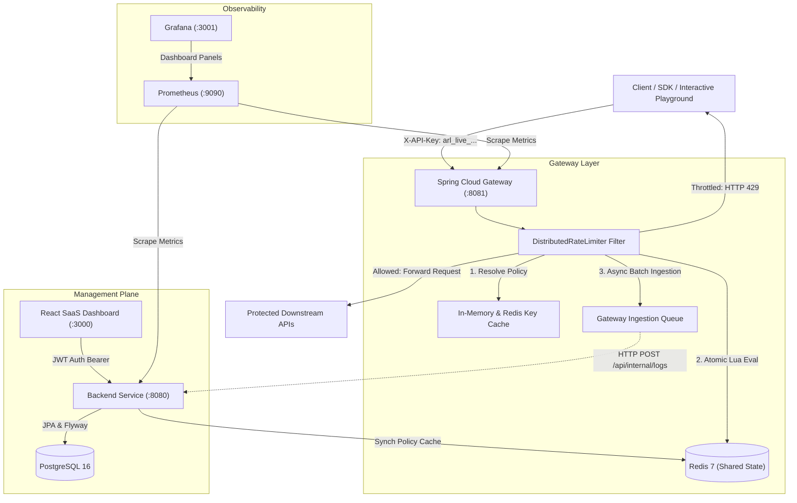

# API Rate Limiter — Distributed API Rate Limiting Platform

[](https://openjdk.org/)
[](https://spring.io/projects/spring-boot)
[](https://spring.io/projects/spring-cloud)
[-red.svg)](https://redis.io/)
[](https://www.postgresql.org/)
[](https://react.dev/)
[](https://www.docker.com/)

A high-performance, production-style distributed API rate limiting platform built with **Java 21**, **Spring Boot 3**, **Spring Cloud Gateway**, **Redis Lua scripts**, **PostgreSQL**, and a **React 18 Developer Dashboard**.

Designed to safeguard microservices from traffic surges and denial-of-service conditions, the platform enforces rate limits centrally through atomic Redis Lua operations across multiple gateway and backend instances.

---

## 1. Architecture Overview



---

## 2. Technology Stack

- **Backend**: Java 21, Spring Boot 3.3.4, Spring Security, Spring Data JPA, Flyway, Spring Validation, Spring Actuator, Springdoc OpenAPI.
- **Gateway**: Spring Cloud Gateway 2023.0.3 (reactive non-blocking WebFlux), Reactive Spring Data Redis.
- **Data & Caching**: PostgreSQL 16, Redis 7 (atomic Lua scripts for zero race conditions).
- **Frontend**: React 18, Vite, Tailwind CSS, Lucide React, Recharts, Axios, React Router v6.
- **Observability**: Prometheus (scraping Spring Actuator Micrometer metrics), Grafana (with provisioned dashboards).
- **Testing**: JUnit 5, Mockito, Spring Boot MockMvc tests, deterministic concurrency tests, Vitest + React Testing Library.
- **DevOps**: Docker, Docker Compose multi-stage builds.

---

## 3. Four Core Rate-Limiting Algorithms

The platform genuinely implements and provides independent Redis Lua scripts for four distinct algorithms:

| Algorithm | Mechanism | State in Redis | Trade-offs |
| :--- | :--- | :--- | :--- |
| **Token Bucket** | Tokens accumulate steadily up to max burst capacity; each request consumes tokens. | Redis Hash (`tokens`, `lastRefillMs`) | Excellent for handling bursts while enforcing steady baseline rate. $O(1)$ complexity. |
| **Sliding Window Log** | Records request timestamps into a Redis Sorted Set (`ZSET`), removing records older than window. | Redis Sorted Set (`ZSET`) | Microsecond accuracy; completely eliminates boundary burst spikes. $O(\log N)$ complexity. |
| **Fixed Window Counter** | Simple integer counter incremented per window bucket; expires at boundary. | Redis String integer | Ultra-low memory footprint, fast $O(1)$ operations; susceptible to boundary bursts. |
| **Leaky Bucket** | Requests fill a virtual queue leaking at a constant rate; overflows are rejected. | Redis Hash (`water`, `lastLeakMs`) | Paces downstream traffic at a strictly constant throughput. $O(1)$ complexity. |

For complete mathematical models, Lua scripts, and implementation analysis, see [rate-limiting-algorithms.md](docs/rate-limiting-algorithms.md).

---

## 4. Repository Structure

```
api-rate-limiter/
├── README.md                      # Platform documentation & quickstart
├── docker-compose.yml             # 7-service orchestration
├── Makefile                       # Convenience build & run targets
├── .env.example                   # Environment configuration template
├── docs/                          # Architecture & technical deep dives
│   ├── architecture.md
│   ├── api-documentation.md
│   ├── rate-limiting-algorithms.md
│   ├── database-schema.md
│   └── setup-guide.md
├── backend/                       # Spring Boot 3.3 Management API
│   ├── pom.xml
│   └── src/
│       ├── main/java/com/apiratelimiter/
│       │   ├── ApiRateLimiterApplication.java
│       │   ├── config/            # Security, Redis, OpenAPI, Seed Data
│       │   ├── security/          # JWT provider, filters, UserPrincipal
│       │   ├── controller/        # Auth, Keys, Policies, Analytics, Protected API
│       │   ├── dto/               # Strong typed DTO records
│       │   ├── entity/            # JPA entities (User, ApiKey, Policy, Logs)
│       │   ├── ratelimit/         # Engine & 4 algorithm implementations
│       │   └── service/           # Auth, Key, Policy, and Analytics services
│       └── resources/
│           ├── application.yml
│           ├── db/migration/      # Flyway schema V1 & seed data
│           └── redis/             # Lua rate limiting scripts
├── gateway/                       # Spring Cloud Gateway
│   ├── pom.xml
│   └── src/
│       ├── main/java/com/apiratelimiter/gateway/
│       │   ├── GatewayApplication.java
│       │   ├── config/            # Reactive Redis & WebClient config
│       │   ├── filter/            # DistributedRateLimiterGatewayFilterFactory
│       │   └── service/           # KeyResolutionService & GatewayLogService
│       └── resources/
│           ├── application.yml
│           └── redis/             # Lua rate limiting scripts
├── frontend/                      # React 18 + Vite SaaS Dashboard
│   ├── package.json
│   ├── vite.config.js
│   ├── tailwind.config.js
│   └── src/
│       ├── components/            # Layout, Badges, Modals, StatCards, Charts
│       ├── pages/                 # Overview, Keys, Policies, Playground, Analytics, Blocked
│       ├── context/               # Auth, Theme, and Toast contexts
│       └── services/              # Axios API clients
├── infrastructure/
│   ├── prometheus/prometheus.yml  # Metric scrape configuration
│   └── grafana/                   # Provisioned datasources & dashboard JSON
└── scripts/
    ├── start.sh / start.bat       # Platform startup scripts
    └── stop.sh / stop.bat         # Teardown scripts
```

---

## 5. Quickstart: Running with Docker Compose

### Step 1: Clone and Configure Environment
```bash
cp .env.example .env
```

### Step 2: Build & Start All Services
```bash
docker compose up -d --build
```

### Step 3: Open the Dashboard
Open your browser at **[http://localhost:3000](http://localhost:3000)**.

---

## 6. Default Ports & Service Endpoints

| Component | Port | URL | Description |
| :--- | :--- | :--- | :--- |
| **Frontend Dashboard** | `3000` | [http://localhost:3000](http://localhost:3000) | React SaaS management interface |
| **Backend API** | `8080` | [http://localhost:8080](http://localhost:8080) | Management plane REST API |
| **Swagger UI** | `8080` | [http://localhost:8080/swagger-ui.html](http://localhost:8080/swagger-ui.html) | OpenAPI documentation |
| **Gateway** | `8081` | [http://localhost:8081](http://localhost:8081) | Distributed Rate Limiter Gateway |
| **Prometheus** | `9090` | [http://localhost:9090](http://localhost:9090) | Actuator metrics scraper |
| **Grafana** | `3001` | [http://localhost:3001](http://localhost:3001) | Dashboards (`admin` / `admin`) |
| **PostgreSQL** | `5432` | `localhost:5432` | PostgreSQL database |
| **Redis** | `6379` | `localhost:6379` | Shared Redis state store |

---

## 7. Demo Accounts & Walkthrough Workflow

### Pre-Configured Demo Accounts:
| Role | Username | Password | Privileges |
| :--- | :--- | :--- | :--- |
| **Administrator** | `admin` | `admin123` | Full access: create/edit/delete policies, view all keys & logs |
| **Developer** | `developer` | `dev123` | Generate own API keys, test in Playground, view analytics |

### Pre-Configured Demo API Key:
- **Raw Secret Key**: `arl_live_demo1234567890abcdef1234`
- **Assigned Policy**: Token Bucket Burst Tier (10 req/10s, capacity 20, refill 5/s)

---

## 8. Sample cURL Workflow

### 1. Authenticate & Obtain JWT Token
```bash
curl -X POST http://localhost:8080/api/auth/login \
  -H "Content-Type: application/json" \
  -d '{"username": "admin", "password": "admin123"}'
```

### 2. Generate an API Key (Hashed Storage)
```bash
curl -X POST http://localhost:8080/api/keys \
  -H "Authorization: Bearer <YOUR_JWT_TOKEN>" \
  -H "Content-Type: application/json" \
  -d '{"name": "My Service Key", "policyId": 1}'
```

### 3. Send Permitted Request Through Gateway
```bash
curl -i -X GET http://localhost:8081/protected-api/data \
  -H "X-API-Key: arl_live_demo1234567890abcdef1234"
```
**Response**:
```http
HTTP/1.1 200 OK
Content-Type: application/json
X-RateLimit-Limit: 20
X-RateLimit-Remaining: 19
X-RateLimit-Reset: 10
X-RateLimit-Algorithm: TOKEN_BUCKET

{
  "status": "success",
  "message": "Protected data payload retrieved successfully",
  "data": { "activeConnections": 1420, "cacheHitRatio": 0.942 }
}
```

### 4. Trigger Rate Limiting (Observe HTTP 429)
Send rapid consecutive requests (or use the Playground's **Burst Test** button):
```bash
for i in {1..25}; do curl -s -o /dev/null -w "%{http_code}\n" http://localhost:8081/protected-api/data -H "X-API-Key: arl_live_demo1234567890abcdef1234"; done
```
**HTTP 429 Response**:
```http
HTTP/1.1 429 Too Many Requests
Content-Type: application/json
X-RateLimit-Limit: 20
X-RateLimit-Remaining: 0
Retry-After: 4
X-RateLimit-Algorithm: TOKEN_BUCKET

{
  "status": 429,
  "error": "Too Many Requests",
  "message": "Rate limit exceeded for policy 'Token Bucket Burst Tier'. Please retry after 4 seconds.",
  "algorithm": "TOKEN_BUCKET",
  "limit": 20,
  "remaining": 0,
  "retryAfterSeconds": 4
}
```

---

## 9. Running Tests

### Backend Tests
```bash
./mvn.cmd clean test -pl backend
```
Executes all 18 automated unit and integration tests including:
- Unit tests for Fixed Window, Sliding Window, Token Bucket, and Leaky Bucket.
- Deterministic multi-threaded concurrency tests.
- JWT token validation and password hashing verification.
- MockMvc HTTP endpoint integration tests.

### Gateway Tests
```bash
./mvn.cmd test -pl gateway
```

### Frontend Tests
```bash
cd frontend && npm test
```

---

## 10. Security & Quality Architecture

- **Hashed API Key Storage**: Keys are generated using `SecureRandom` with prefix `arl_live_`. Only the SHA-256 hash is persisted in PostgreSQL; the full key is shown only once upon generation.
- **Fail-Open vs. Fail-Closed**: Configurable via `RATE_LIMIT_FAIL_OPEN`. Defaults to `false` (Fail-Closed) to ensure upstream services cannot be flooded when Redis is unavailable.
- **Bounded Metric Labels**: Actuator Prometheus metrics avoid using dynamic parameters or raw API keys as metric labels to prevent metric cardinality explosion.
- **Asynchronous Log Ingestion**: Gateway buffers incoming request logs in a non-blocking queue and batch-flushes to the backend asynchronously, ensuring zero latency overhead on client requests.
