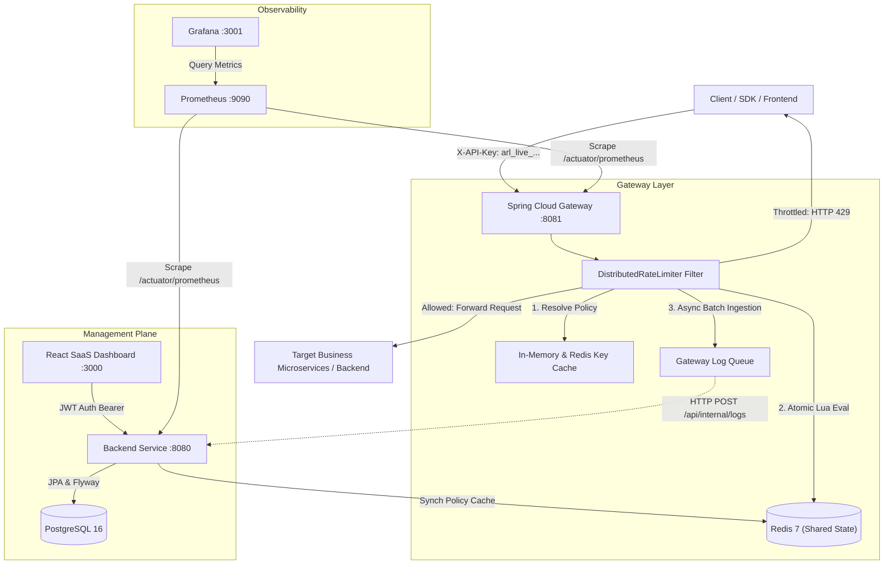

# System Architecture — Distributed API Rate Limiting Platform

## 1. High-Level Architecture Overview

The **API Rate Limiter** platform is engineered as a production-grade, distributed rate-limiting infrastructure designed to protect downstream backend microservices from volumetric spikes, abuse, and denial-of-service conditions.

Rate limiting state is synchronized centrally using **Redis**, ensuring that independent gateway instances and backend services share identical quota counters without drift or race conditions.

---

## 2. Component Breakdown

### 2.1 Spring Cloud Gateway (Port 8081)
- Non-blocking, reactive HTTP gateway built on Project Reactor and Spring WebFlux.
- Intercepts requests destined for protected downstream routes (`/protected-api/**`).
- Extracts client credentials via `X-API-Key`, `Authorization: Bearer <key>`, or query parameter `api_key`.
- Computes cryptographic SHA-256 hash of raw API keys to look up policy assignments.
- Dispatches atomic Redis Lua scripts corresponding to the assigned algorithm (`FIXED_WINDOW`, `SLIDING_WINDOW`, `TOKEN_BUCKET`, `LEAKY_BUCKET`).
- Mutates response headers:
  - `X-RateLimit-Limit`: Maximum quota configured for the window.
  - `X-RateLimit-Remaining`: Remaining request allowance in current window/bucket.
  - `X-RateLimit-Reset`: Seconds remaining until quota reset.
  - `X-RateLimit-Algorithm`: Active rate-limiting algorithm applied.
  - `Retry-After`: Computed seconds client must wait before subsequent retry (sent on HTTP 429).
- Non-blocking asynchronous log buffering sends traffic samples to the backend without adding gateway latency.

### 2.2 Management Backend Service (Port 8080)
- Traditional Spring Boot 3.3.x application with Spring Data JPA, Flyway, and Spring Security.
- Manages authentication (JWT with HMAC-SHA256), User RBAC (`ROLE_ADMIN`, `ROLE_USER`).
- Issues cryptographically secure API keys (`arl_live_...`), storing only SHA-256 digests in PostgreSQL.
- Exposes REST endpoints for CRUD on rate limit policies, key revocation, and time-series analytics.
- Serves mock downstream business endpoints (`/protected-api/data`, `/users`, `/orders`, `/echo`) for testing.

### 2.3 Shared Redis State Store (Port 6379)
- Stores distributed rate limiter counters, sliding window ordered sets, and token bucket timestamps.
- All evaluation logic executes atomically inside Redis using Lua scripts:
  - Eliminates check-then-act race conditions.
  - Sub-millisecond evaluation latency ($O(1)$ to $O(\log N)$).
  - Guarantees exact limit enforcement across multiple gateway instances.

### 2.4 PostgreSQL Database (Port 5432)
- Stores durable configuration and historical operational data:
  - `users`: User credentials and RBAC roles.
  - `rate_limit_policies`: Policy configurations and algorithm parameters.
  - `api_keys`: Key metadata, SHA-256 hashes, status, and expiration dates.
  - `request_logs`: Ingested traffic telemetry for dashboard charts.
  - `audit_logs`: Audit trail of administrative configuration actions.

### 2.5 React Developer Dashboard (Port 3000)
- Modern SaaS interface built with React 18, Vite, and Tailwind CSS.
- Interactive API Playground: sends live requests through Gateway, measures round-trip latency, displays quota headers, and supports rapid burst stress testing (1x, 5x, 10x, 20x).
- Real-time Recharts traffic visualizations and algorithm distribution charts.
- Dark/Light mode theme switching with glassmorphism aesthetic.

---

## 3. Distributed Redis Key Design

| Key Format | Data Structure | TTL | Purpose |
| :--- | :--- | :--- | :--- |
| `rl:fw:{key}:{windowBucket}` | Integer String | `windowSec + 1` | Fixed Window counter for bucket |
| `rl:sw:{key}` | Sorted Set (ZSET) | `windowSec + 2` | Sliding Window microsecond log |
| `rl:tb:{key}` | Hash (`tokens`, `lastRefillMs`) | `capacity / rate * 2` | Token Bucket balance & timestamp |
| `rl:lb:{key}` | Hash (`water`, `lastLeakMs`) | `capacity / rate * 2` | Leaky Bucket queue water level |
| `cache:keyinfo:{keyHash}` | String (JSON / colon-delimited) | 300 seconds | Gateway policy resolution cache |

---

## 4. Fail-Open vs. Fail-Closed Modes

The platform supports a configurable fallback policy via `ratelimiter.fail-open`:

1. **Fail-Closed (`RATE_LIMIT_FAIL_OPEN=false`, Default)**:
   - If Redis connection drops or times out, requests are blocked with HTTP 503 or 429.
   - **Rationale**: Prioritizes protecting backend services and preventing downstream outages during cache infrastructure degradation.

2. **Fail-Open (`RATE_LIMIT_FAIL_OPEN=true`)**:
   - If Redis connection drops, requests are permitted through with an added header `X-RateLimit-Fallback: FAIL_OPEN`.
   - **Rationale**: Used in applications where service availability takes precedence over quota compliance.
