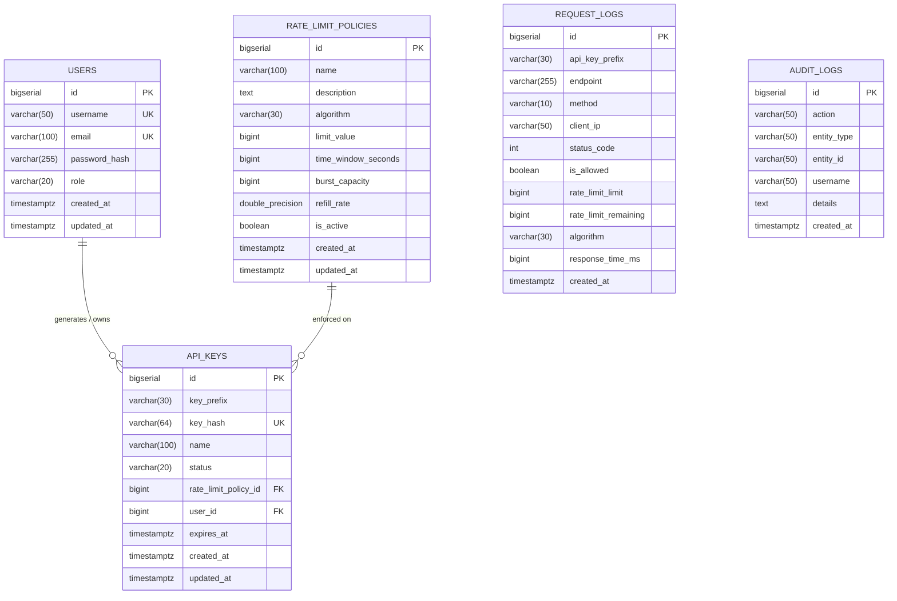

# PostgreSQL Database Schema — Distributed API Rate Limiter

This document details the relational database schema managed via **Flyway migrations** (`db/migration/V1__init_schema.sql`).

---

## 1. Entity-Relationship Diagram

---

## 2. Table Specifications

### 2.1 `users`
Stores user identities, administrative credentials, and role assignments.

| Column | Type | Constraints | Description |
| :--- | :--- | :--- | :--- |
| `id` | `BIGSERIAL` | `PRIMARY KEY` | Unique user surrogate identifier |
| `username` | `VARCHAR(50)` | `NOT NULL, UNIQUE` | Unique username for authentication |
| `email` | `VARCHAR(100)` | `NOT NULL, UNIQUE` | User email address |
| `password_hash` | `VARCHAR(255)` | `NOT NULL` | BCrypt password hash ($2a$10$...) |
| `role` | `VARCHAR(20)` | `NOT NULL` | `ROLE_ADMIN` or `ROLE_USER` |
| `created_at` | `TIMESTAMPTZ` | `DEFAULT NOW()` | Record creation timestamp |
| `updated_at` | `TIMESTAMPTZ` | `DEFAULT NOW()` | Record last modification timestamp |

---

### 2.2 `rate_limit_policies`
Defines rate limiting rules, algorithmic model, request allowances, and time windows.

| Column | Type | Constraints | Description |
| :--- | :--- | :--- | :--- |
| `id` | `BIGSERIAL` | `PRIMARY KEY` | Policy primary key |
| `name` | `VARCHAR(100)` | `NOT NULL` | Human-readable policy title |
| `description` | `TEXT` | `NULLABLE` | Documentation or rationale for policy |
| `algorithm` | `VARCHAR(30)` | `NOT NULL` | `FIXED_WINDOW`, `SLIDING_WINDOW`, `TOKEN_BUCKET`, `LEAKY_BUCKET` |
| `limit_value` | `BIGINT` | `NOT NULL` | Max permitted requests per window |
| `time_window_seconds` | `BIGINT` | `NOT NULL` | Window duration in seconds |
| `burst_capacity` | `BIGINT` | `NULLABLE` | Max token bucket or leaky bucket capacity |
| `refill_rate` | `DOUBLE PRECISION`| `NULLABLE` | Tokens refilled or leaked per second |
| `is_active` | `BOOLEAN` | `NOT NULL, DEFAULT TRUE` | Active enforcement toggle |
| `created_at` | `TIMESTAMPTZ` | `DEFAULT NOW()` | Creation timestamp |
| `updated_at` | `TIMESTAMPTZ` | `DEFAULT NOW()` | Last update timestamp |

---

### 2.3 `api_keys`
Stores client API credentials linked to users and policies.

| Column | Type | Constraints | Description |
| :--- | :--- | :--- | :--- |
| `id` | `BIGSERIAL` | `PRIMARY KEY` | Key record ID |
| `key_prefix` | `VARCHAR(30)` | `NOT NULL` | Masked prefix for display (e.g. `arl_live_abc...`) |
| `key_hash` | `VARCHAR(64)` | `NOT NULL, UNIQUE` | SHA-256 digest of complete secret key |
| `name` | `VARCHAR(100)` | `NOT NULL` | Identifying name (e.g. "Mobile iOS Client") |
| `status` | `VARCHAR(20)` | `NOT NULL, DEFAULT 'ACTIVE'` | `ACTIVE`, `REVOKED`, `EXPIRED` |
| `rate_limit_policy_id` | `BIGINT` | `NOT NULL, FK` | References `rate_limit_policies(id)` |
| `user_id` | `BIGINT` | `NOT NULL, FK` | References `users(id)` ON DELETE CASCADE |
| `expires_at` | `TIMESTAMPTZ` | `NULLABLE` | Optional key expiration timestamp |
| `created_at` | `TIMESTAMPTZ` | `DEFAULT NOW()` | Creation timestamp |
| `updated_at` | `TIMESTAMPTZ` | `DEFAULT NOW()` | Modification timestamp |

---

### 2.4 `request_logs`
High-speed analytics table storing traffic events traversing the distributed gateway.

| Column | Type | Constraints | Description |
| :--- | :--- | :--- | :--- |
| `id` | `BIGSERIAL` | `PRIMARY KEY` | Event ID |
| `api_key_prefix` | `VARCHAR(30)` | `NULLABLE` | Display prefix of calling client key |
| `endpoint` | `VARCHAR(255)` | `NOT NULL` | Downstream route targeted |
| `method` | `VARCHAR(10)` | `NOT NULL` | HTTP method (`GET`, `POST`, etc.) |
| `client_ip` | `VARCHAR(50)` | `NULLABLE` | Client remote IP address |
| `status_code` | `INT` | `NOT NULL` | HTTP response code (`200`, `429`, etc.) |
| `is_allowed` | `BOOLEAN` | `NOT NULL` | Boolean flag for fast aggregation |
| `rate_limit_limit` | `BIGINT` | `NULLABLE` | Policy limit at evaluation time |
| `rate_limit_remaining` | `BIGINT` | `NULLABLE` | Remaining quota in window |
| `algorithm` | `VARCHAR(30)` | `NULLABLE` | Algorithm evaluated (`TOKEN_BUCKET`, etc.) |
| `response_time_ms` | `BIGINT` | `NULLABLE` | Round-trip request processing latency |
| `created_at` | `TIMESTAMPTZ` | `DEFAULT NOW()` | Event timestamp |

---

## 3. Database Indexes

To maintain sub-millisecond query execution on analytical queries and key validation lookups, the following B-tree indexes are defined:

- `idx_api_keys_hash`: Index on `api_keys(key_hash)` for instant $O(1)$ key verification during gateway authentication.
- `idx_api_keys_user`: Index on `api_keys(user_id)` for listing user keys.
- `idx_api_keys_status`: Index on `api_keys(status)` for active key filtering.
- `idx_req_logs_created_at`: Index on `request_logs(created_at)` for fast time-series aggregation.
- `idx_req_logs_allowed`: Index on `request_logs(is_allowed)` for calculating acceptance vs. rejection ratios.
- `idx_req_logs_prefix`: Index on `request_logs(api_key_prefix)` for per-key traffic audits.
